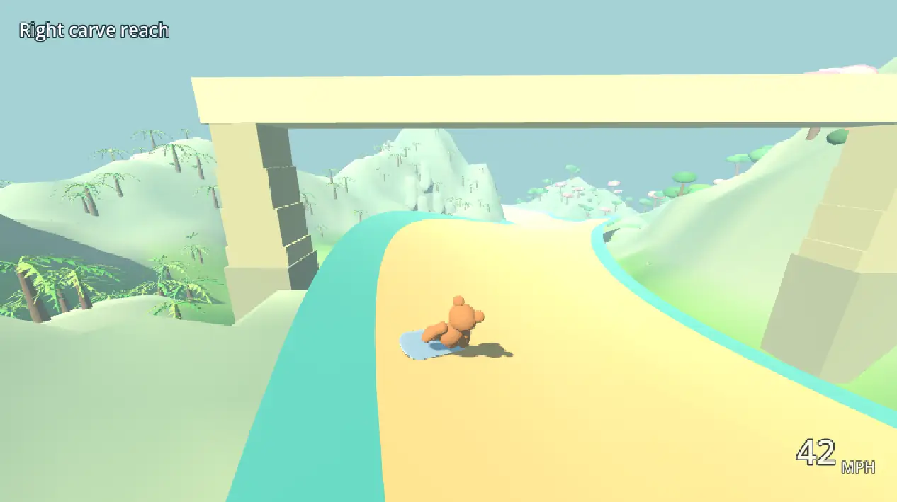

<h1 align="center">Dreamsurf</h1>

An endless downhill board-riding game with tropical scenery and freestyle tricks.

**[Releases](https://github.com/T3L3SIS/Dreamsurf/releases)** · **[What's changed](CHANGELOG.md)** · **[Windows compatibility](WINDOWS.md)** · **[Checksums](SHA256SUMS.txt)**

Dreamsurf is a small independent, AI-assisted Godot project. Ride as a teddy bear across stylized tropical landscapes, bring your own music, or learn increasingly elaborate combinations inspired by snowboarding and skateboarding. There is no mandatory progression.

## Modes

| Mode | Description |
| --- | --- |
| Flow | Relaxed downhill riding |
| Freestyle | Scored tricks, branching combos, wide flat sections and optional jumps |
| Exploration | Unscored exploration |
| Practice | A gentle snowy beginner slope for experimenting with tricks |

## Controls (defaults)

| Key | Action |
| --- | --- |
| A / D | Steer |
| W | Accelerate; double-tap and hold to tuck |
| S | Brake / airborne middle grab |
| Shift | Carve |
| Space | Jump / loaded pop |
| Arrow keys | Directional tricks |
| S + hold left/right arrow in air | Controlled grab spin |
| R / V / Esc | Reset / camera / pause |

Movement and trick bindings are customizable. The in-game six-tab trick guide explains timing, releases and chains. Full controller support is deferred.

## Development

Current development milestone: **v0.28.2.7**. Compared with the first public release, [v0.25.12](https://github.com/T3L3SIS/Dreamsurf/releases/tag/v0.25.12), the trick system is more interconnected, Freestyle has a dedicated park layout, and Practice is a separate snowfield. Read the [cumulative changelog](CHANGELOG.md) for the full overview.

Next: technical maturity, performance and stability. Future environmental expansion and controller support are planned without a fixed schedule.

## Download / source

Use the [Releases page](https://github.com/T3L3SIS/Dreamsurf/releases) for playable Windows packages and the Godot project archive. Extract the chosen ZIP completely before opening it. Godot is not needed to play the Windows builds. To edit the project, use Godot 4.7.1 and import the extracted project.godot.

The current milestone targets Windows x64 and x32; ARM64 is not included in the new packages. See [Windows notes](WINDOWS.md) for security and graphics troubleshooting.

## Licensing

Godot is MIT-licensed; the Windows packages and source project contain Godot's license and third-party copyright notices. Those notices do not grant a license to Dreamsurf's own code or assets. No separate open-source license is declared here; consult the project owner for reuse permissions. Additional asset provenance and notice coverage have not been independently audited.
