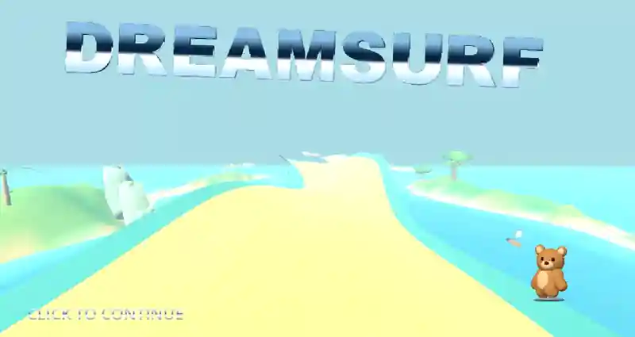
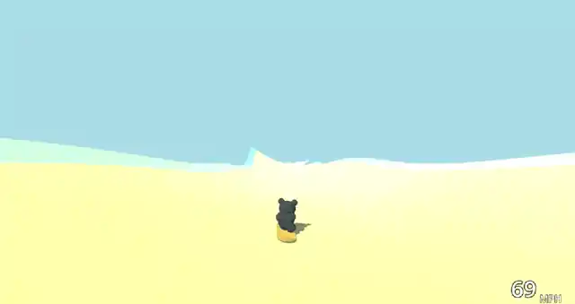
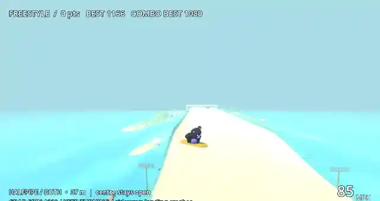
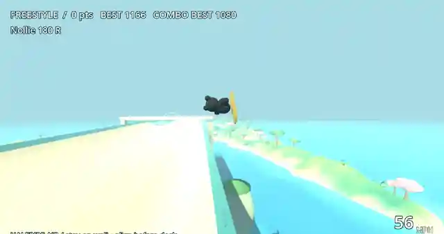
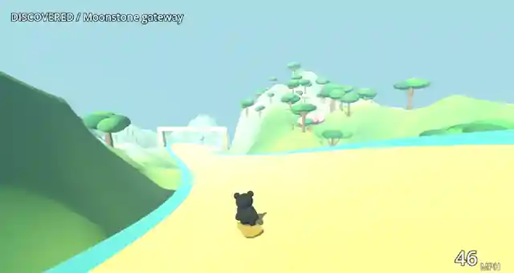
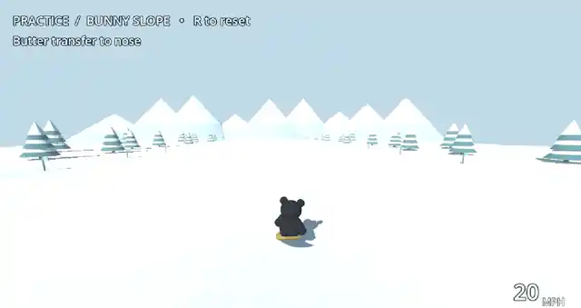

<h1 align="center">Dreamsurf</h1>

An endless downhill boardsport game.

<a href="https://github.com/T3L3SIS/Dreamsurf/releases"><strong>Download Dreamsurf</strong></a> &nbsp;·&nbsp; <a href="CHANGELOG.md">Development history</a>

Dreamsurf is a small, independent game about riding downhill through a dreamlike world of pastel islands, winding slopes, turquoise water and strange little landmarks. You ride as a teddy bear on a board, somewhere between snowboarding, longboarding and surfing.

It's as much about the feeling of movement as it is about tricks. Put on your own music and carve for a while, discover a different route, or spend time learning how to link presses, spins, grabs and grinds into a single run. There is no mandatory progression.

## Ways to ride

*Screenshots from v0.29.5, from the 0.29 development cycle.*

### Flow

Unscored downhill riding. Wide carving arcs, gentle rollers and long banked turns leave room to choose your own line. The emphasis is on rhythm, momentum and the landscape.

### Freestyle

| Aerial tricks | Halfpipe |
| :---: | :---: |
|  |  |

A downhill terrain park for expressive, linked tricks. Butter across flat sections, launch from big jumps and halfpipe walls, or find your way onto a pair of grind rails. Chase a score if you want, or simply experiment with how the board moves.

### Exploration

Take a less direct route. Scenic terraces, branching paths, ruins and quiet gardens offer different views and discoveries. The exploration journal records the places you find, without putting you on a timer.

### Practice / Bunny Slope

A gentle, snowy slope with room to repeat tricks at lower speeds. Learn the movement at your own pace, away from scores and park features. An in-game trick guide is available whenever you need it.

## Development

Dreamsurf is an independent, AI-assisted project built with Godot. It began as a small boardsport experiment and is evolving around the feel of riding, expressive animation and varied environments.

**Next release candidate: v0.29.5.2.** The 0.29 development cycle reorganizes the underlying code, refines the plush rider, and substantially expands the terrain and trick possibilities across the three main modes.

The [releases page](https://github.com/T3L3SIS/Dreamsurf/releases) lists the builds currently available to download. The [development history](CHANGELOG.md) covers the current candidate and previous public milestones.

## Download and technical information

Download a Windows build from [Releases](https://github.com/T3L3SIS/Dreamsurf/releases), extract the entire archive and launch the executable. No Godot installation is needed to play. Godot project archives, when provided, can be imported into Godot 4.7.1.

[Windows compatibility and security](WINDOWS.md) · [Download checksums](SHA256SUMS.txt)

Godot is MIT-licensed; supplied project and Windows archives include its license and third-party notices. Those notices do not license Dreamsurf's own code or assets. No separate open-source license is currently declared; contact the project owner about reuse.
