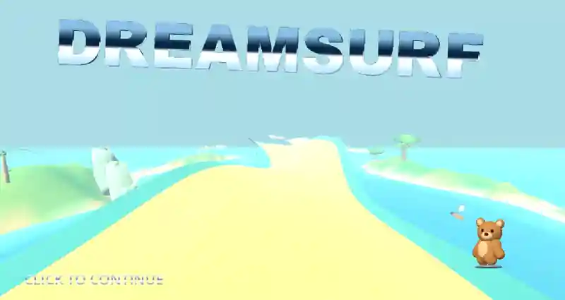

The third public milestone of Dreamsurf, following [v0.28.2.7](https://github.com/T3L3SIS/Dreamsurf/releases/tag/v0.28.2.7). The 0.29 development cycle gives each riding mode a more distinct identity, expands the freestyle park and rebuilds the teddy's animations.

## What's changed

### Freestyle
- Higher optional speeds, larger jumps and a new XL big-air feature with longer airtime for full grab spins.
- Symmetrical halfpipe sections with contained wall aerials. The board follows the invisible extension of the lip through ascent and descent while aerial tricks remain available.
- Precision grind rails and wide boxes, now paired for same-rail hops and rail-to-rail transfers.
- 50-50s, boardslides, nosepresses and tailpresses, with dedicated balancing poses, smoother transitions and linked aerial exits.
- New loaded body 360s, directional grab tweaks, alley-oop-style rotations and edge-to-end / end-to-edge butter exchanges.
- A seven-tab trick guide, including a dedicated Park section. The center riding lane remains open for uninterrupted flatland combos.

### Flow
- Wider carving ribbons, broad banked turns and gentle rollers.
- Final comfort tuning softens the new terrain and allows wider player-chosen carving lines without increasing speed limits.

### Exploration
- Wider scenic terraces and alternating high/low routes through branching passages.
- New ruins, gardens, overlooks and route-specific discoveries in the exploration journal.
- Still unscored, with no timers or mandatory progression.

### Teddy and interface
- Shorter, fuller plush limbs, continuous rounded paw geometry and improved hip attachment and board clearance.
- Corrected regular stance, smoother carving arm movement and edge transitions, revised speed-tuck and grind poses.
- Expanded randomized title-screen trick demonstrations using the shared rider rig.
- Unified, more legible settings dialog with explicit Save and discard behavior. Scrolling no longer changes slider values. Version information comes from the project configuration.
- Practice retains its familiar snowy Bunny Slope.

### Under the hood
- Major source restructuring separates riding, tricks, rigging, terrain, presentation, camera, input, audio and settings into dedicated scripts.
- Expanded regression tests, dependency maps and profiling documentation.
- Previous Freestyle records are preserved; the expanded park uses separate score and combo record categories.
- Windows ANGLE compatibility configuration and Godot licensing notices are retained in the project.

## Downloads

Choose the Windows archive matching your system from the assets below. Extract the entire ZIP before running the executable; Godot is not required to play. The Godot project archive is intended for editing with Godot 4.7.1.

Windows packages are unsigned unless explicitly stated otherwise. Keep security protection enabled and verify the files against the published checksums. Checksums establish file identity, not malware safety.

[Full changelog](https://github.com/T3L3SIS/Dreamsurf/blob/main/CHANGELOG.md) · [Windows compatibility](https://github.com/T3L3SIS/Dreamsurf/blob/main/WINDOWS.md) · [SHA-256 checksums](https://github.com/T3L3SIS/Dreamsurf/blob/main/SHA256SUMS.txt)

Full controller support and a cinematic replay system remain future development goals.
